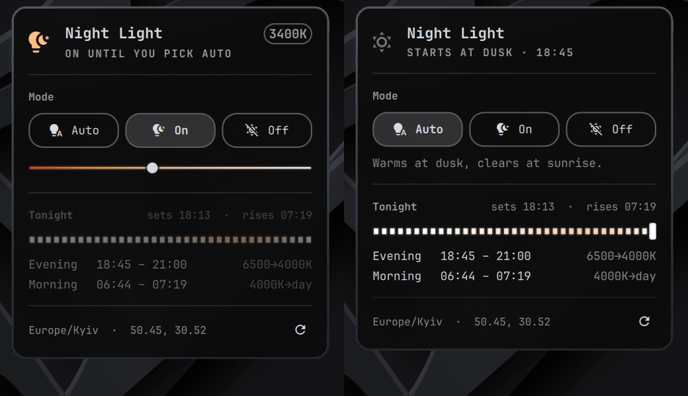

# Night Light



A night light for Omarchy that follows the sun. The screen warms on a ramp that starts at
**real local dusk**, deepens through the evening, and climbs back to daylight at dawn.
When you want something else, the panel has a slider: pick any temperature and hold it.

Omarchy's built-in night light is a switch: `Super + Ctrl + N` flips between 4000 K and
6500 K. hyprsunset can also follow the clock, but only the clock — its profiles key on a
fixed `HH:MM` and there is no interpolation between them. So an evening that gets
gradually warmer means a ladder of profiles, and a ladder anchored to dusk has to be
rebuilt as dusk moves. That is what this does.

```
17:30            sunset — still light out, so nothing happens
17:54  6500K     civil dusk: the ramp starts at the daytime value
18:22  6400K     nautical dusk, properly dark now — still imperceptible
18:56  5750K     the first real warmth
19:58  4300K
21:00  3000K     fully warm, at the hour you asked for
06:12  untinted  sunrise
```

It starts at **dusk rather than sunset**, from the daytime temperature rather than a
warmer one, and on a curve that holds near neutral early. Sunset is still daylight; a
filter that becomes visible then reads as firing too early. Nothing here steps — the first
rung is the value already on screen.

It finishes at **a clock time you choose**, not after a fixed number of hours. Dusk moves
by well over an hour across the year, so a fixed duration drifts full tint towards
midnight in summer. Pinning the end instead means the ramp stretches through winter and
compresses in summer, and is always fully warm when you want to be winding down.

## Install

```bash
omarchy plugin add https://github.com/devSviat/omarchy-nightlight --enable
```

That places the plugin and its bar widget, and nothing else: the plugin is inert until
you open its panel. The panel shows exactly what setup would change, with a button to
agree. Nothing is written to your configuration until you press it.

Agreeing changes these, and only these:

- `~/.config/hypr/hyprsunset.conf` — replaced with a generated schedule. Whatever is
  there now is copied to `hyprsunset.conf.pre-nightlight` first.
- `systemctl --user enable --now hyprsunset.service` — see
  [below](#hyprsunset-runs-from-systemd-not-autostartlua). Warns if `autostart.lua`
  already launches hyprsunset, since two launch paths race for its socket.
- `~/.config/systemd/user/nightlight.{service,timer}` — the daily rebuild.
- `~/.config/omarchy/hooks/post-boot.d/nightlight.sh` — rebuild at login.
- `~/.config/nightlight/config.json` — created only if you do not have one.
- `~/.local/bin/nightlight` — a symlink to the CLI, skipped if that name is taken.

Nothing under `/usr/share/omarchy` is touched at any point, and nothing reaches the
network.

Prefer a terminal? `~/.config/omarchy/plugins/sviat.nightlight/bin/nightlight setup`
prints the same list and waits for you to type `yes`.

### From a checkout

```bash
git clone https://github.com/devSviat/omarchy-nightlight
cd omarchy-nightlight
./install.sh
```

`install.sh` links the checkout in as the plugin, adds the bar widget, and hands over to
`nightlight setup`. Useful flags: `--place-only` stops after placing files, `--no-bar`
skips the widget, `--yes` accepts the changes without prompting.

### Coming from omarchy-nightlight-auto

This started as a fork of
[omarchy-nightlight-auto](https://github.com/matt-shearing/omarchy-nightlight-auto) and
keeps its settings format. Undo the old one first, so it hands your original
`hyprsunset.conf` back, then install this:

```bash
nightlight-auto teardown
omarchy plugin remove contra.nightlight
omarchy plugin add https://github.com/devSviat/omarchy-nightlight --enable
```

Setup copies `~/.config/nightlight-auto/config.json` across if you have not made a new
one. `pause` and `resume` are now `off` and `auto`, and `generate` is `apply`.

## Remove

```bash
nightlight teardown
omarchy plugin remove sviat.nightlight
```

`teardown` undoes everything setup did: puts your original `hyprsunset.conf` back (or
restores Omarchy's default if you did not have one), disables and removes the timer and
the post-boot hook, removes the `nightlight` symlink, and hands hyprsunset's launch back
the way it found it. Your settings are left alone; to drop those too:

```bash
rm -rf ~/.config/nightlight ~/.local/state/nightlight
```

## Use

The bar widget shows the stage of the evening — a sun before the ramp starts, then a
setting sun, a crescent moon, and a new moon once it reaches the floor. Click it for the
panel, right-click to switch the night light off and back to Auto. It turns the urgent
colour only when hyprsunset is not running, because that is the one state where nothing
is being applied at all.

The panel has three modes:

- **Auto** follows tonight's ladder.
- **On** holds one temperature around the clock. A slider appears under the buttons;
  the screen follows it as you drag, and the value is remembered. It is separate from
  the schedule's `night_temp`, so tuning it does not change what Auto does.
- **Off** holds untinted.

On and Off stay until you pick Auto again.

Adjusting the held temperature, in On:

| | |
| --- | --- |
| Drag the slider | 1000 K – 6500 K, in steps of 50 |
| Scroll over the slider or the temperature badge | 100 K a notch |
| `↑` `↓`, `k` `j`, `+` `-` | 100 K a press |
| Right-click the slider, or double-click the badge | back to `night_temp` |

Other keys in the panel: `←` `→` / `h` `l` then `Enter` to choose a mode, `r` to rebuild,
`s` to show or hide the settings.

### Keyboard tint

On ASUS ROG laptops Omarchy paints the keyboard backlight in the theme's colour. The
tune button in the panel's footer opens the settings, where **Keyboard → Follow tint**
warms that colour along with the screen: the theme colour as-is at 6500 K, blended
towards amber as the screen warms, and almost all amber by about 4000 K. Off, daytime and
**Theme** give the plain theme colour back.

It is off by default and needs `asusctl`. The keyboard catches up with the evening ramp
within a minute. While it is on, a `theme-set` hook re-tints the keyboard straight after a
theme change, because Omarchy paints the plain theme colour at that point. Only the colour
changes; brightness and the backlight's on/off state are left alone.

### From a terminal

```bash
nightlight status         # what is on screen now, and what is next
nightlight show           # tonight's whole ladder
nightlight show --date 2026-12-21
nightlight auto           # follow the sunset ramp
nightlight on             # hold the manual temperature until `auto`
nightlight on 3400        # ...and set it at the same time
nightlight off            # hold untinted until `auto`
nightlight toggle         # off, or back to auto if already off
nightlight temp           # print the manual temperature
nightlight temp 3400      # set it; also +100 / -100 / reset
nightlight keyboard on    # warm the keyboard backlight with the screen; `off` to stop
nightlight apply          # rebuild now (the timer does this daily)
nightlight setup --print  # what setup would change, without changing it
nightlight teardown       # undo everything setup did
```

### From a script or a keybinding

```bash
omarchy-shell sviat.nightlight status
omarchy-shell sviat.nightlight on | off | auto | toggle | mode
omarchy-shell sviat.nightlight temp 3400      # or +100 / -100
omarchy-shell sviat.nightlight rebuild
omarchy-shell shell toggle sviat.nightlight   # open the panel
```

### Using the indicator instead of a bar widget

If you would rather not have a second night light icon, `indicators/NightLight.qml`
replaces the stock mark in the centre-bar indicator cluster with one that follows the
ramp. Clone the indicators widget, drop the file in, and leave this plugin out of the bar:

```bash
omarchy plugin clone omarchy.indicators
cp indicators/NightLight.qml ~/.config/omarchy/plugins/<you>.indicators/indicators/
omarchy restart shell
```

Then in `~/.config/omarchy/shell.json`, remove the `sviat.nightlight` entry from
`bar.layout` and add `{ "id": "sviat.nightlight" }` to the top-level `plugins` array —
that keeps the plugin enabled so its service still loads, without placing a widget.

Clicking switches the night light off, clicking again returns to Auto. The mark stays on
screen while off — an inactive indicator is given `opacity: 0` and `interactive: false`,
so a mark that hid itself would take the only control for undoing that with it.

The mark falls back to the stock `omarchy.nightlight` toggle if this plugin is ever
disabled, so it keeps working either way.

## Configuration

`~/.config/nightlight/config.json`:

| Key | Default | Meaning |
| --- | --- | --- |
| `latitude`, `longitude` | `null` | `null` derives both from the system time zone |
| `evening_temp` | `6500` | Kelvin at the start of the ramp. The daytime value, so it begins from no tint |
| `night_temp` | `3000` | Kelvin at the deepest point |
| `day_temp` | `null` | `null` means untinted; a number tints the day too |
| `ramp_anchor` | `civil_dusk` | `sunset`, `civil_dusk`, `nautical_dusk` or `astronomical_dusk` |
| `full_tint_by` | `"21:00"` | Clock time to reach `night_temp`. `null` uses `ramp_minutes` instead |
| `ramp_start_offset_min` | `0` | Minutes relative to the anchor; negative starts earlier |
| `ramp_minutes` | `300` | Fixed ramp length, used only when `full_tint_by` is `null` |
| `min_ramp_minutes` | `45` | Floor, for when dusk falls close to the target |
| `step_minutes` | `20` | Ladder granularity |
| `ramp_curve_power` | `2.0` | `1.0` is a straight line; higher holds near daylight longer |
| `morning_offset_min` | `0` | Minutes relative to sunrise for the return to day |
| `morning_anchor` | `null` | `civil_dawn`, `nautical_dawn` or `astronomical_dawn` ramps back to day from there; `null` returns to day in one step at sunrise |
| `fallback_sunset`, `fallback_sunrise` | `18:00`, `06:00` | Used only where the sun does not rise or set |
| `round_to_kelvin` | `50` | Rounds emitted temperatures, to keep the file readable |
| `keyboard_tint` | `false` | Warm the ASUS keyboard backlight with the screen; set from the panel or `nightlight keyboard on` |

Run `nightlight apply` after editing, and `nightlight show` to see the result before
committing to it.

**Location comes from your time zone.** tzdata ships a representative latitude and
longitude for every zone in `zone1970.tab`, so `Europe/Kyiv` is enough to place you
within a few kilometres — far inside the minute or two of precision sunset timing needs.
Change the system time zone and the schedule follows. Set `latitude` / `longitude` if you
want your actual coordinates.

**The shape of the ramp.** Temperatures are interpolated in **mireds** (reciprocal
megakelvin) rather than Kelvin, because even steps there are what read as an even ramp
to the eye — linear Kelvin steps crowd all the visible change into the warm end. On top
of that, `ramp_curve_power` biases the movement towards later in the evening, so the
first hour does very little. Set it to `1.0` for a straight line.

An early-hours `full_tint_by` such as `"01:00"` is taken as the following morning. A time
that has already passed by the time it gets dark keeps a short ramp rather than inverting
it.

**Mornings.** By default the day comes back in a single step at sunrise. Set
`morning_anchor` to a dawn twilight and the ladder climbs back instead: from the night
floor at that dawn (or `min_ramp_minutes` before sunrise, whichever is earlier) to a hair
below daylight at sunrise, then untinted. It uses the same `step_minutes` and
`ramp_curve_power`, which on the way up means holding the warm value while it is still
dark and doing most of the brightening in the last stretch before the sun is up.

**Anchors.** Sunset is when the sun's disc goes down and it is still light. Civil dusk
(sun 6° below) is about when you would reach for a lamp; by nautical dusk (12°) it is
properly dark. The gap between them widens the further you are from the equator. Where
the sun never reaches the chosen altitude — a high-latitude summer — it falls back to
sunset.

## How it fits into Omarchy

### Consent

Every write to your configuration goes through `apply`, and `apply` refuses to run until
a consent record exists at `~/.local/state/nightlight/consent.json`. Only `setup` creates
that record, and only after printing the full list of changes and getting a `yes`. The
bar panel shows that same list — it renders `setup --print` verbatim, so the text you
agree to is the text that governs what happens.

The record also stores what was true beforehand — whether `hyprsunset.service` was
already enabled, where the old config was saved — so `teardown` can put things back
rather than guess.

It writes `~/.config/hypr/hyprsunset.conf`, which is Omarchy's documented place for a
night light schedule. `omarchy toggle nightlight` still works and still wins — until the
next step in the ladder fires, at most `step_minutes` later. For a hold that lasts, use
On or Off.

All state lives in a single `service` plugin. Bar widgets are instantiated once per
monitor and an indicator mark is instantiated twice over — active strip and hover
fold-out — so anything holding its own copy of the state would drift, and clicking one
copy would leave the others stale. The panel is read-only; every side effect goes
through the one singleton.

### hyprsunset runs from systemd, not autostart.lua

The Omarchy manual suggests `o.launch_on_start("hyprsunset")`. This uses
`systemctl --user enable hyprsunset.service` instead — the unit the hyprsunset package
already ships — for a specific reason.

hyprsunset reads its config only at startup, so loading a rebuilt schedule means
restarting it. `omarchy-restart-app` relaunches through uwsm, which asks the user manager
for a transient scope. **A scope created from inside a systemd service does not outlive
that service.** Run from the timer, hyprsunset comes up, answers on its socket, and is
then killed the instant the oneshot exits. Restarting the unit has no such problem.

Running both launch paths would race for hyprsunset's socket, so there is only the one.
If you also have the `autostart.lua` line, remove it.

### Changing a hold without a restart

Restarting hyprsunset drops the tint for a moment, which is fine once a day at 3 am and
not fine under a slider. So while On or Off is held, a change goes to the running
hyprsunset over its socket and is written to the config in the same step, with no
restart.

That leaves hyprsunset with the old value in memory, and it re-applies the profile it
loaded every midnight. The timer's 23:55 pass notices the difference and restarts it
then, once. Leaving Auto always restarts, because a loaded ladder would overrule the
hold at its next rung.

## Tests

```bash
python3 tests/test_schedule.py
python3 tests/test_keyboard.py
```

Covers the solar math against published almanac times for Brisbane, London (across a DST
boundary), New York and Nairobi; polar day and polar night; the ladder's shape, ordering,
clamping and mired spacing; the rendered config; consent, setup and teardown in a
throwaway home; the morning ramp; the three modes; and the manual hold against a
stand-in hyprsunset — that a change is applied live, and when a restart is still needed.
The keyboard tests cover the colour curve and, against a stand-in `asusctl`, that it is
only called when the colour changes and that turning the tint off or tearing down hands
the theme colour back.

## Requirements

Omarchy 4 (Quattro), `hyprsunset` 0.4 or newer, Python 3.10 or newer. No external Python
packages and no other dependencies — the solar calculation is stdlib arithmetic.
`systemd` comes with Omarchy. Keyboard tint additionally needs `asusctl`.

## Credits

Built on [omarchy-nightlight-auto](https://github.com/matt-shearing/omarchy-nightlight-auto)
by contra, which is where the sunset ladder, the consent flow and the solar math come
from.

## Licence

MIT — see [LICENSE](LICENSE).
